# ParkBenchDB schema

> Generated from `schema/parkbench-schema.yaml` by `tools/gen_docs.py`. Do not edit by hand.

## Purpose and scope

ParkBenchDB is a synthetic retail-banking transaction database for **OpenEdge 12.8** benchmarking. It has 32 tables, 479 fields and 198 indexes, chosen to cover a wide mix of row counts, record sizes, LOB usage and index shapes. Every table has a dense sequential ID and three indexed random fields (`RandomInt10`, `RandomInt100`, `RandomInt1000`), so benchmark scripts can select random subsets or single rows without knowing valid IDs.

The history window is 12 months, ending on the load's as-of date (last day of the month before the load). All data is synthetic. This documentation describes the schema only; creating the database, loading data and writing benchmarks are separate work.

## Conventions

- **Tables**: PascalCase, singular (`DebitTransaction`).
- **Fields**: PascalCase. The sequential ID is `<Table>Id`. A foreign key reuses the parent's ID name (`AccountId`); when one table has two keys to the same parent, the role is a prefix (`FromAccountId`, `ToAccountId`). Currency and country are referenced by ISO code (`CurrencyCode`, `CountryCode`).
- **Indexes**: `Pk<Table>` = primary unique ID index, `Ux…` = other unique, `Ix…` = non-unique, `Wx…` = word index. The RandomInt indexes are always `IxRandomInt10`, `IxRandomInt100`, `IxRandomInt1000`.
- **Identifiers**: letters and digits only (no hyphens), at most 32 characters, and never an OpenEdge SQL, SQL-92 or ABL reserved word (see `tools/reserved_words.txt`), so every name works unquoted in both ABL and OpenEdge SQL.
- **No extent (array) fields** are used anywhere in the schema. Repeating values are separate fields or child rows.
- **0 and `?`**: an optional foreign key is mandatory with 0 meaning "none"; optional dates and LOBs use the unknown value `?`.

### Standard fields (every table, in this order)

| Field | Type | Format | Mandatory | Initial | Description |
|---|---|---|---|---|---|
| `<Table>Id` | INT64 | `>>>>>>>>>>>9` | Y | `0` | Dense sequential identifier, 1..N with no gaps after the initial load. Runtime inserts use NEXT-VALUE(Seq&lt;Table>Id). |
| `RandomInt10` | INTEGER | `>9` | Y | `0` | Independent uniform random value 1–10 for selecting ≈ 10% subsets. 0 = unassigned (invalid). |
| `RandomInt100` | INTEGER | `>>9` | Y | `0` | Independent uniform random value 1–100 for selecting ≈ 1% subsets. 0 = unassigned (invalid). |
| `RandomInt1000` | INTEGER | `>>>9` | Y | `0` | Independent uniform random value 1–1000 for selecting ≈ 0.1% subsets. 0 = unassigned (invalid). |
| `CreatedAt` | DATETIME-TZ | `99/99/9999 HH:MM:SS.SSS+HH:MM` | Y | `NOW` | When the row was created. For historical rows, a synthetic timestamp consistent with the row's business date. |
| `UpdatedAt` (class M only, last field) | DATETIME-TZ | `99/99/9999 HH:MM:SS.SSS+HH:MM` | Y | `NOW` | Last modification time; equals CreatedAt right after the load. |

### Standard indexes (every table)

| Index | Components | Primary | Unique | Purpose |
|---|---|---|---|---|
| `Pk<Table>` | &lt;Table>Id ASC | Y | Y | Single-row random access by sequential ID; default scan order |
| `IxRandomInt10` | RandomInt10 ASC, &lt;Table>Id ASC | N | N | Select ≈ 10% of rows (RandomInt10 = k) |
| `IxRandomInt100` | RandomInt100 ASC, &lt;Table>Id ASC | N | N | Select ≈ 1% of rows (RandomInt100 = k) |
| `IxRandomInt1000` | RandomInt1000 ASC, &lt;Table>Id ASC | N | N | Select ≈ 0.1% of rows (RandomInt1000 = k) |

### Format strings

| Kind | Type | Decimals | Format |
|---|---|---|---|
| Money | DECIMAL | 2 | `->>>,>>>,>>>,>>9.99` (max 999,999,999,999.99) |
| Interest rate (%) | DECIMAL | 4 | `>>9.9999` |
| FX rate | DECIMAL | 8 | `>>>>>9.99999999` |
| Percent | DECIMAL | 2 | `>>9.99` |
| ID / foreign key | INT64 | – | `>>>>>>>>>>>9` |
| Date | DATE | – | `99/99/9999` |
| Datetime (local) | DATETIME | – | `99/99/9999 HH:MM:SS.SSS` |
| Datetime-TZ | DATETIME-TZ | – | `99/99/9999 HH:MM:SS.SSS+HH:MM` |
| Logical | LOGICAL | – | `yes/no` |
| Character | CHARACTER | – | `x(n)`; SQL width (MAX-WIDTH) = 2 × n |

## Benchmark access guide

### Guarantees

| # | Guarantee |
|---|-----------|
| G1 | Fields `RandomInt10`, `RandomInt100` and `RandomInt1000` exist on every table (INTEGER). Their values are independent and uniform over 1..10, 1..100 and 1..1000. |
| G2 | Indexes `IxRandomInt10`, `IxRandomInt100` and `IxRandomInt1000` exist on every table, as `(RandomIntN, <Table>Id)`. |
| G3 | `<Table>Id` is unique and INT64. Immediately after a load it is dense over 1..MaxId. |
| G4 | `BenchmarkTableInfo` has one row per table, holding `TableRowCount` and `MaxId` for that load. |
| G5 | Foreign keys named `<Parent>Id` point at `<Parent>.<Parent>Id`. An optional FK uses 0 for "none". |
| G6 | RandomInt values are drawn independently at random, so any single value may match **zero rows** on tables with fewer than about 10× its range (e.g. `RandomInt1000 = k` on a 250-row table). Scripts must handle empty subsets. On such tables, prefer `RandomInt10`, or the single-row pattern. |

### Patterns

**Subset of about p% of rows**:

| Target | Filter | Notes |
|--------|--------|-------|
| 10% | `RandomInt10 = k`, k in 1..10 | |
| 1% | `RandomInt100 = k` | |
| 0.1% | `RandomInt1000 = k` | |
| 5% | `RandomInt100 <= 5` | a range on the same index |
| 0.01% | `RandomInt100 = a AND RandomInt1000 = b` | the fields are independent; one index is used, the other is filtered |

**Single random row**:
1. Read `MaxId` from `BenchmarkTableInfo WHERE TableName = '<Table>'`.
2. Draw `r` uniformly in 1..MaxId.
3. Look up `<Table>Id = r`.
4. If no row is found (possible only after deletes or rollbacks), draw again.

**Parent-driven navigation**: select parents by `RandomInt100 = k`, then follow each parent's child index (e.g. `Customer` → `AccountHolder.IxCustomerAccount` → `Account` → `DebitTransaction.IxAccountPosted`).

**Repeatable runs**: pass `k` (and any seeds) in as benchmark parameters. Because `<Table>Id` is the second component of each RandomInt index, the order of rows within a subset is deterministic.

### Examples

ABL:

```abl
FIND BenchmarkTableInfo NO-LOCK WHERE BenchmarkTableInfo.TableName = "Customer".
FOR EACH Customer NO-LOCK WHERE Customer.RandomInt100 = 42 USE-INDEX IxRandomInt100:
    FOR EACH AccountHolder NO-LOCK WHERE AccountHolder.CustomerId = Customer.CustomerId,
        FIRST Account NO-LOCK WHERE Account.AccountId = AccountHolder.AccountId:
        /* work */
    END.
END.
```

SQL:

```sql
SELECT COUNT(*) FROM PUB.DebitTransaction WHERE RandomInt1000 = 7;
SELECT * FROM PUB.Account WHERE AccountId = ?;   -- ? drawn from 1..MaxId
```

### Rules for scripts that change data

- An INSERT must assign all three RandomInt fields in range, and take `<Table>Id` from `NEXT-VALUE(Seq<Table>Id)`.
- New debit and credit transactions use `AccountStatementId = 0`.
- Scripts that change data must restore the database from the post-load backup before the next measured run. Otherwise G3 and G4 are no longer guaranteed.

## Summary matrix

Rows and tiers are at scale factor 1. *Indexes* counts the 4 standard indexes plus the table-specific ones.

| # | Table | Class | Rows @SF1 | Scaling | Avg rec (B) | Size tier | Volume tier | LOB | Indexes | Area |
|---|---|---|---|---|---|---|---|---|---|---|
| 1 | [Currency](tables/Currency.md) | R | 40 | fixed | 70 | Narrow | Tiny | none | 5 (1 extra) | `PB_Ref_Data` |
| 2 | [Country](tables/Country.md) | R | 250 | fixed | 80 | Narrow | Tiny | none | 6 (2 extra) | `PB_Ref_Data` |
| 3 | [ExchangeRate](tables/ExchangeRate.md) | R | 14,235 | fixed | 70 | Narrow | Small | none | 5 (1 extra) | `PB_Ref_Data` |
| 4 | [Branch](tables/Branch.md) | R | 250 | fixed | 300 | Standard | Tiny | none | 6 (2 extra) | `PB_Ref_Data` |
| 5 | [Employee](tables/Employee.md) | M | 5,000 | linear | 330 | LOB | Small | BLOB | 7 (3 extra) | `PB_Ref_Data` |
| 6 | [AccountType](tables/AccountType.md) | R | 24 | fixed | 1,500 | Wide | Tiny | none | 6 (2 extra) | `PB_Ref_Data` |
| 7 | [InterestRateHistory](tables/InterestRateHistory.md) | R | 2,880 | fixed | 60 | Narrow | Small | none | 5 (1 extra) | `PB_Ref_Data` |
| 8 | [TransactionType](tables/TransactionType.md) | R | 60 | fixed | 110 | Narrow | Tiny | none | 6 (2 extra) | `PB_Ref_Data` |
| 9 | [MerchantCategory](tables/MerchantCategory.md) | R | 600 | fixed | 110 | Narrow | Tiny | none | 5 (1 extra) | `PB_Ref_Data` |
| 10 | [Merchant](tables/Merchant.md) | M | 80,000 | linear | 300 | Standard | Small | none | 8 (4 extra) | `PB_Ref_Data` |
| 11 | [Customer](tables/Customer.md) | M | 1,000,000 | linear | 850 | Wide | Medium | none | 9 (5 extra) | `PB_Master_Wide` |
| 12 | [CustomerAddress](tables/CustomerAddress.md) | M | 1,500,000 | linear | 220 | Standard | Medium | none | 6 (2 extra) | `PB_Master_Std` |
| 13 | [CustomerContact](tables/CustomerContact.md) | M | 2,500,000 | linear | 110 | Narrow | Medium | none | 6 (2 extra) | `PB_Master_Narrow` |
| 14 | [CustomerDocument](tables/CustomerDocument.md) | M | 1,000,000 | linear | 200 | LOB | Medium | BLOB | 6 (2 extra) | `PB_Master_Std` |
| 15 | [CustomerNote](tables/CustomerNote.md) | T | 1,500,000 | linear | 380 | LOB | Medium | CLOB | 7 (3 extra) | `PB_Master_Std` |
| 16 | [Account](tables/Account.md) | M | 1,500,000 | linear | 300 | Standard | Medium | none | 8 (4 extra) | `PB_Master_Std` |
| 17 | [AccountHolder](tables/AccountHolder.md) | M | 2,000,000 | linear | 70 | Narrow | Medium | none | 6 (2 extra) | `PB_Master_Narrow` |
| 18 | [Payee](tables/Payee.md) | M | 2,500,000 | linear | 250 | Standard | Medium | none | 5 (1 extra) | `PB_Master_Std` |
| 19 | [ScheduledPayment](tables/ScheduledPayment.md) | M | 1,000,000 | linear | 180 | Standard | Medium | none | 7 (3 extra) | `PB_Master_Std` |
| 20 | [Card](tables/Card.md) | M | 1,200,000 | linear | 230 | Standard | Medium | none | 7 (3 extra) | `PB_Master_Std` |
| 21 | [Loan](tables/Loan.md) | M | 250,000 | linear | 900 | Wide | Medium | none | 7 (3 extra) | `PB_Master_Wide` |
| 22 | [StatementDocument](tables/StatementDocument.md) | T | 150,000 | linear | 160 | LOB | Medium | CLOB + BLOB | 5 (1 extra) | `PB_Master_Std` |
| 23 | [AccountStatement](tables/AccountStatement.md) | T | 18,000,000 | linear | 190 | LOB | Large | CLOB | 6 (2 extra) | `PB_Txn_Large` |
| 24 | [MonthlyBalance](tables/MonthlyBalance.md) | T | 18,000,000 | linear | 160 | Standard | Large | none | 6 (2 extra) | `PB_Txn_Large` |
| 25 | [CreditTransaction](tables/CreditTransaction.md) | T | 18,000,000 | linear | 170 | Standard | Large | none | 7 (3 extra) | `PB_Txn_Large` |
| 26 | [Transfer](tables/Transfer.md) | T | 6,000,000 | linear | 100 | Narrow | Large | none | 7 (3 extra) | `PB_Txn_Large` |
| 27 | [LoanPayment](tables/LoanPayment.md) | T | 6,000,000 | linear | 100 | Narrow | Large | none | 6 (2 extra) | `PB_Txn_Large` |
| 28 | [LoginEvent](tables/LoginEvent.md) | T | 12,000,000 | linear | 120 | Narrow | Large | none | 5 (1 extra) | `PB_Txn_Large` |
| 29 | [DebitTransaction](tables/DebitTransaction.md) | T | 50,000,000 | linear | 170 | Standard | Very Large | none | 8 (4 extra) | `PB_Txn_Debit` |
| 30 | [CardAuthorization](tables/CardAuthorization.md) | T | 50,000,000 | linear | 100 | Narrow | Very Large | none | 6 (2 extra) | `PB_Txn_CardAuth` |
| 31 | [AuditLog](tables/AuditLog.md) | T | 50,000,000 | linear | 110 | Narrow | Very Large | none | 4 (0 extra) | `PB_Txn_Audit` |
| 32 | [BenchmarkTableInfo](tables/BenchmarkTableInfo.md) | R | 32 | fixed | 90 | Narrow | Tiny | none | 5 (1 extra) | `PB_Ref_Data` |

## Tier coverage

| Group | Count | Required | OK | Source | Tables |
|---|---|---|---|---|---|
| Volume: Tiny | 7 | ≥ 2 | ✔ | FR-017 | Currency, Country, Branch, AccountType, TransactionType, MerchantCategory, BenchmarkTableInfo |
| Volume: Small | 4 | ≥ 2 | ✔ | FR-017 | ExchangeRate, Employee, InterestRateHistory, Merchant |
| Volume: Medium | 12 | ≥ 2 | ✔ | FR-017 | Customer, CustomerAddress, CustomerContact, CustomerDocument, CustomerNote, Account, AccountHolder, Payee, ScheduledPayment, Card, Loan, StatementDocument |
| Volume: Large | 6 | ≥ 2 | ✔ | FR-017 | AccountStatement, MonthlyBalance, CreditTransaction, Transfer, LoanPayment, LoginEvent |
| Volume: Very Large | 3 | ≥ 2 | ✔ | FR-017 | DebitTransaction, CardAuthorization, AuditLog |
| Size: Narrow | 14 | ≥ 2 | ✔ | FR-018 | Currency, Country, ExchangeRate, InterestRateHistory, TransactionType, MerchantCategory, CustomerContact, AccountHolder, Transfer, LoanPayment, LoginEvent, CardAuthorization, AuditLog, BenchmarkTableInfo |
| Size: Standard | 10 | ≥ 2 | ✔ | FR-018 | Branch, Merchant, CustomerAddress, Account, Payee, ScheduledPayment, Card, MonthlyBalance, CreditTransaction, DebitTransaction |
| Size: Wide | 3 | ≥ 2 | ✔ | FR-018 | AccountType, Customer, Loan |
| Size: LOB-bearing | 5 | ≥ 2 | ✔ | FR-018 | Employee, CustomerDocument, CustomerNote, StatementDocument, AccountStatement |
| LOB: has CLOB | 3 | ≥ 2 | ✔ | FR-019 | CustomerNote, StatementDocument, AccountStatement |
| LOB: has BLOB | 3 | ≥ 2 | ✔ | FR-019 | Employee, CustomerDocument, StatementDocument |
| LOB: has both | 1 | ≥ 1 | ✔ | FR-019 | StatementDocument |
| Class: R (Reference) | 9 | ≥ 3 | ✔ | US3 | Currency, Country, ExchangeRate, Branch, AccountType, InterestRateHistory, TransactionType, MerchantCategory, BenchmarkTableInfo |
| Class: M (Master) | 12 | ≥ 3 | ✔ | US3 | Employee, Merchant, Customer, CustomerAddress, CustomerContact, CustomerDocument, Account, AccountHolder, Payee, ScheduledPayment, Card, Loan |
| Class: T (Transactional) | 11 | ≥ 3 | ✔ | US3 | CustomerNote, StatementDocument, AccountStatement, MonthlyBalance, CreditTransaction, Transfer, LoanPayment, LoginEvent, DebitTransaction, CardAuthorization, AuditLog |
| LOB: none (majority) | 27 | > 16 | ✔ | FR-019 | — |

### Index shapes

| Shape | Examples |
|---|---|
| Single-field | Currency.UxCurrencyCode |
| Multi-field | ExchangeRate.UxCurrencyPairDate |
| Unique, non-primary | Currency.UxCurrencyCode |
| Descending component | ExchangeRate.UxCurrencyPairDate, InterestRateHistory.UxTypeEffective, CustomerNote.IxCustomerDate, AccountStatement.UxAccountPeriod, CreditTransaction.IxAccountPosted, LoanPayment.IxLoanPayment, LoginEvent.IxCustomerTime, DebitTransaction.IxAccountPosted, CardAuthorization.IxCardDate |
| Word index | Merchant.WxMerchantName, CustomerNote.WxSummary |
| Standard indexes only | AuditLog |
| Character-key join | Country.DefaultCurrencyCode → Currency.CurrencyCode |

## Entity-relationship diagram

`||--o{` = one parent, many children; `||--o|` = at most one child per parent; `|o` on the parent side = optional FK (0 = none).

```mermaid
erDiagram
    Currency ||--o{ Country : "DefaultCurrencyCode"
    Currency ||--o{ ExchangeRate : "FromCurrencyCode"
    Currency ||--o{ ExchangeRate : "ToCurrencyCode"
    Country ||--o{ Branch : "CountryCode"
    Branch ||--o{ Employee : "BranchId"
    AccountType ||--o{ InterestRateHistory : "AccountTypeId"
    Employee ||--o{ InterestRateHistory : "ChangedByEmployeeId"
    MerchantCategory ||--o{ Merchant : "MerchantCategoryId"
    Country ||--o{ Merchant : "CountryCode"
    Branch ||--o{ Customer : "HomeBranchId"
    Customer ||--o{ CustomerAddress : "CustomerId"
    Country ||--o{ CustomerAddress : "CountryCode"
    Customer ||--o{ CustomerContact : "CustomerId"
    Customer ||--o{ CustomerDocument : "CustomerId"
    Country ||--o{ CustomerDocument : "IssuingCountryCode"
    Employee ||--o{ CustomerDocument : "VerifiedByEmployeeId"
    Customer ||--o{ CustomerNote : "CustomerId"
    Employee ||--o{ CustomerNote : "EmployeeId"
    AccountType ||--o{ Account : "AccountTypeId"
    Branch ||--o{ Account : "BranchId"
    Currency ||--o{ Account : "CurrencyCode"
    Account ||--o{ AccountHolder : "AccountId"
    Customer ||--o{ AccountHolder : "CustomerId"
    Customer ||--o{ Payee : "CustomerId"
    Account ||--o{ ScheduledPayment : "AccountId"
    Payee ||--o{ ScheduledPayment : "PayeeId"
    Account ||--o{ Card : "AccountId"
    Customer ||--o{ Card : "CustomerId"
    Customer ||--o{ Loan : "CustomerId"
    Account ||--o{ Loan : "DisbursementAccountId"
    Employee ||--o{ Loan : "LoanOfficerEmployeeId"
    AccountStatement ||--o| StatementDocument : "AccountStatementId"
    Account ||--o{ AccountStatement : "AccountId"
    Account ||--o{ MonthlyBalance : "AccountId"
    Account ||--o{ CreditTransaction : "AccountId"
    TransactionType ||--o{ CreditTransaction : "TransactionTypeId"
    AccountStatement |o--o{ CreditTransaction : "AccountStatementId"
    Account ||--o{ Transfer : "FromAccountId"
    Account ||--o{ Transfer : "ToAccountId"
    DebitTransaction ||--o| Transfer : "DebitTransactionId"
    CreditTransaction ||--o| Transfer : "CreditTransactionId"
    Loan ||--o{ LoanPayment : "LoanId"
    DebitTransaction |o--o| LoanPayment : "DebitTransactionId"
    Customer ||--o{ LoginEvent : "CustomerId"
    Account ||--o{ DebitTransaction : "AccountId"
    TransactionType ||--o{ DebitTransaction : "TransactionTypeId"
    AccountStatement |o--o{ DebitTransaction : "AccountStatementId"
    Merchant |o--o{ DebitTransaction : "MerchantId"
    Card ||--o{ CardAuthorization : "CardId"
    Merchant ||--o{ CardAuthorization : "MerchantId"
    Currency ||--o{ CardAuthorization : "CurrencyCode"
    DebitTransaction |o--o| CardAuthorization : "DebitTransactionId"
    Employee |o--o{ AuditLog : "EmployeeId"
```



### Relationships

| Child | FK field | Parent | Cardinality (avg / min–max per parent) | Optional | Indexed |
|---|---|---|---|---|---|
| [Country](tables/Country.md) | `DefaultCurrencyCode` | [Currency](tables/Currency.md).`CurrencyCode` | 6 / 1–60 | N | Y |
| [ExchangeRate](tables/ExchangeRate.md) | `FromCurrencyCode` | [Currency](tables/Currency.md).`CurrencyCode` | 356 / 0–365 (USD has 0) | N | Y |
| [ExchangeRate](tables/ExchangeRate.md) | `ToCurrencyCode` | [Currency](tables/Currency.md).`CurrencyCode` | 356 / 0–14,235 (all rows reference USD) | N | N: Always USD; second component of UxCurrencyPairDate |
| [Branch](tables/Branch.md) | `CountryCode` | [Country](tables/Country.md).`CountryCode` | 1 / 0–225 (US 90%) | N | Y |
| [Employee](tables/Employee.md) | `BranchId` | [Branch](tables/Branch.md).`BranchId` | 20 / 5–750 (head office ≈ 750) | N | Y |
| [InterestRateHistory](tables/InterestRateHistory.md) | `AccountTypeId` | [AccountType](tables/AccountType.md).`AccountTypeId` | 120 / 120–120 | N | Y |
| [InterestRateHistory](tables/InterestRateHistory.md) | `ChangedByEmployeeId` | [Employee](tables/Employee.md).`EmployeeId` | 0.6 / 0–10 | N | N: Audit-only reference |
| [Merchant](tables/Merchant.md) | `MerchantCategoryId` | [MerchantCategory](tables/MerchantCategory.md).`MerchantCategoryId` | 133 / 0–2,000 (skewed) | N | Y |
| [Merchant](tables/Merchant.md) | `CountryCode` | [Country](tables/Country.md).`CountryCode` | 320 / 0–68,000 (US 85%) | N | Y |
| [Customer](tables/Customer.md) | `HomeBranchId` | [Branch](tables/Branch.md).`BranchId` | 4,000 / 500–15,000 | N | Y |
| [CustomerAddress](tables/CustomerAddress.md) | `CustomerId` | [Customer](tables/Customer.md).`CustomerId` | 1.5 / 1–3 | N | Y |
| [CustomerAddress](tables/CustomerAddress.md) | `CountryCode` | [Country](tables/Country.md).`CountryCode` | 6,000 / 0–1,425,000 (US 95%) | N | Y |
| [CustomerContact](tables/CustomerContact.md) | `CustomerId` | [Customer](tables/Customer.md).`CustomerId` | 2.5 / 1–5 | N | Y |
| [CustomerDocument](tables/CustomerDocument.md) | `CustomerId` | [Customer](tables/Customer.md).`CustomerId` | 1.0 / 0–3 | N | Y |
| [CustomerDocument](tables/CustomerDocument.md) | `IssuingCountryCode` | [Country](tables/Country.md).`CountryCode` | 4,000 / 0–950,000 (US 95%) | N | N: Lookup to Country only |
| [CustomerDocument](tables/CustomerDocument.md) | `VerifiedByEmployeeId` | [Employee](tables/Employee.md).`EmployeeId` | 200 / 0–1,000 | N | N: Lookup to Employee only |
| [CustomerNote](tables/CustomerNote.md) | `CustomerId` | [Customer](tables/Customer.md).`CustomerId` | 1.5 / 0–20 (Zipf) | N | Y |
| [CustomerNote](tables/CustomerNote.md) | `EmployeeId` | [Employee](tables/Employee.md).`EmployeeId` | 300 / 0–2,000 | N | Y |
| [Account](tables/Account.md) | `AccountTypeId` | [AccountType](tables/AccountType.md).`AccountTypeId` | 62,500 / 1,000–450,000 (skewed) | N | Y |
| [Account](tables/Account.md) | `BranchId` | [Branch](tables/Branch.md).`BranchId` | 6,000 / 750–22,500 | N | Y |
| [Account](tables/Account.md) | `CurrencyCode` | [Currency](tables/Currency.md).`CurrencyCode` | 37,500 / 0–1,455,000 (USD 97%) | N | Y |
| [AccountHolder](tables/AccountHolder.md) | `AccountId` | [Account](tables/Account.md).`AccountId` | 1.33 / 1–4 | N | Y |
| [AccountHolder](tables/AccountHolder.md) | `CustomerId` | [Customer](tables/Customer.md).`CustomerId` | 2.0 / 1–8 | N | Y |
| [Payee](tables/Payee.md) | `CustomerId` | [Customer](tables/Customer.md).`CustomerId` | 2.5 / 0–25 | N | Y |
| [ScheduledPayment](tables/ScheduledPayment.md) | `AccountId` | [Account](tables/Account.md).`AccountId` | 0.67 / 0–10 | N | Y |
| [ScheduledPayment](tables/ScheduledPayment.md) | `PayeeId` | [Payee](tables/Payee.md).`PayeeId` | 0.4 / 0–3 | N | Y |
| [Card](tables/Card.md) | `AccountId` | [Account](tables/Account.md).`AccountId` | 0.8 / 0–3 | N | Y |
| [Card](tables/Card.md) | `CustomerId` | [Customer](tables/Customer.md).`CustomerId` | 1.2 / 0–4 | N | Y |
| [Loan](tables/Loan.md) | `CustomerId` | [Customer](tables/Customer.md).`CustomerId` | 0.25 / 0–3 | N | Y |
| [Loan](tables/Loan.md) | `DisbursementAccountId` | [Account](tables/Account.md).`AccountId` | 0.17 / 0–3 | N | N: Lookup to Account only |
| [Loan](tables/Loan.md) | `LoanOfficerEmployeeId` | [Employee](tables/Employee.md).`EmployeeId` | 50 / 0–400 (loan officers only) | N | N: Lookup to Employee only |
| [StatementDocument](tables/StatementDocument.md) | `AccountStatementId` | [AccountStatement](tables/AccountStatement.md).`AccountStatementId` | 0.008 / 0–1 | N | Y |
| [AccountStatement](tables/AccountStatement.md) | `AccountId` | [Account](tables/Account.md).`AccountId` | 12 / 1–12 | N | Y |
| [MonthlyBalance](tables/MonthlyBalance.md) | `AccountId` | [Account](tables/Account.md).`AccountId` | 12 / 1–12 | N | Y |
| [CreditTransaction](tables/CreditTransaction.md) | `AccountId` | [Account](tables/Account.md).`AccountId` | 12 / 0–100 | N | Y |
| [CreditTransaction](tables/CreditTransaction.md) | `TransactionTypeId` | [TransactionType](tables/TransactionType.md).`TransactionTypeId` | 750,000 / 0–7,000,000 | N | N: Same as above |
| [CreditTransaction](tables/CreditTransaction.md) | `AccountStatementId` | [AccountStatement](tables/AccountStatement.md).`AccountStatementId` | 1 / 0–15 | Y (0 = none) | Y |
| [Transfer](tables/Transfer.md) | `FromAccountId` | [Account](tables/Account.md).`AccountId` | 4 / 0–50 | N | Y |
| [Transfer](tables/Transfer.md) | `ToAccountId` | [Account](tables/Account.md).`AccountId` | 4 / 0–50 | N | Y |
| [Transfer](tables/Transfer.md) | `DebitTransactionId` | [DebitTransaction](tables/DebitTransaction.md).`DebitTransactionId` | 0.12 / 0–1 | N | Y |
| [Transfer](tables/Transfer.md) | `CreditTransactionId` | [CreditTransaction](tables/CreditTransaction.md).`CreditTransactionId` | 0.33 / 0–1 | N | N: Reverse lookup handled through the debit side |
| [LoanPayment](tables/LoanPayment.md) | `LoanId` | [Loan](tables/Loan.md).`LoanId` | 24 / 1–60 | N | Y |
| [LoanPayment](tables/LoanPayment.md) | `DebitTransactionId` | [DebitTransaction](tables/DebitTransaction.md).`DebitTransactionId` | 0.06 / 0–1 | Y (0 = none) | N: Lookup to DebitTransaction only |
| [LoginEvent](tables/LoginEvent.md) | `CustomerId` | [Customer](tables/Customer.md).`CustomerId` | 12 / 0–400 (skewed) | N | Y |
| [DebitTransaction](tables/DebitTransaction.md) | `AccountId` | [Account](tables/Account.md).`AccountId` | 33 / 0–400 (skewed) | N | Y |
| [DebitTransaction](tables/DebitTransaction.md) | `TransactionTypeId` | [TransactionType](tables/TransactionType.md).`TransactionTypeId` | 2,500,000 / 0–25,000,000 (POS 50%) | N | N: Tiny parent; an index would have 60 distinct keys over 50M rows |
| [DebitTransaction](tables/DebitTransaction.md) | `AccountStatementId` | [AccountStatement](tables/AccountStatement.md).`AccountStatementId` | 2.8 / 0–40 | Y (0 = none) | Y |
| [DebitTransaction](tables/DebitTransaction.md) | `MerchantId` | [Merchant](tables/Merchant.md).`MerchantId` | 375 / 0–50,000 (Zipf; ≈ 60% of rows set) | Y (0 = none) | Y |
| [CardAuthorization](tables/CardAuthorization.md) | `CardId` | [Card](tables/Card.md).`CardId` | 42 / 0–500 | N | Y |
| [CardAuthorization](tables/CardAuthorization.md) | `MerchantId` | [Merchant](tables/Merchant.md).`MerchantId` | 625 / 0–80,000 (Zipf) | N | Y |
| [CardAuthorization](tables/CardAuthorization.md) | `CurrencyCode` | [Currency](tables/Currency.md).`CurrencyCode` | 1,250,000 / 0–47,500,000 (USD 95%) | N | N: Lookup to Currency only |
| [CardAuthorization](tables/CardAuthorization.md) | `DebitTransactionId` | [DebitTransaction](tables/DebitTransaction.md).`DebitTransactionId` | 0.5 / 0–1 | Y (0 = none) | N: Lookup to DebitTransaction only |
| [AuditLog](tables/AuditLog.md) | `EmployeeId` | [Employee](tables/Employee.md).`EmployeeId` | 3,000 / 0–20,000 | Y (0 = none) | N: Minimal-index table by design (FR-020) |

`AuditLog.TableName` + `AuditLog.RecordId` form a polymorphic reference to any table's `<Table>Id`; it is not a foreign key and is not indexed.

## Storage areas

Type II storage areas with 8,192-byte blocks. Records per block (RPB) follows `RPB ≈ 8192 / (average record size + 20)`, rounded down to a power of two (min 4, max 128), using the largest records in the area. All Tiny and Small tables share `PB_Ref_Data` at 64 RPB regardless of width, because the waste is negligible under 100,000 rows. Blocks per cluster (BPC) is 8 for Tiny/Small, 64 for Medium and 512 for Large/Very Large tables. Indexes and LOB content always live in their own areas.

| Area | Kind | RPB | BPC | Description | Contents |
|---|---|---|---|---|---|
| `PB_Ref_Data` | data | 64 | 8 | All Tiny and Small tables (exempt from the RPB formula; waste is negligible under 100k rows) | Currency, Country, ExchangeRate, Branch, Employee, AccountType, InterestRateHistory, TransactionType, MerchantCategory, Merchant, BenchmarkTableInfo |
| `PB_Master_Narrow` | data | 32 | 64 | Medium Narrow tables | CustomerContact, AccountHolder |
| `PB_Master_Std` | data | 16 | 64 | Medium Standard and LOB-bearing tables | CustomerAddress, CustomerDocument, CustomerNote, Account, Payee, ScheduledPayment, Card, StatementDocument |
| `PB_Master_Wide` | data | 8 | 64 | Medium Wide tables | Customer, Loan |
| `PB_Txn_Debit` | data | 32 | 512 | DebitTransaction (Very Large) in its own area | DebitTransaction |
| `PB_Txn_CardAuth` | data | 64 | 512 | CardAuthorization (Very Large) in its own area | CardAuthorization |
| `PB_Txn_Audit` | data | 32 | 512 | AuditLog (Very Large) in its own area | AuditLog |
| `PB_Txn_Large` | data | 32 | 512 | Large transactional tables | AccountStatement, MonthlyBalance, CreditTransaction, Transfer, LoanPayment, LoginEvent |
| `PB_Ref_Idx` | index | – | 8 | Indexes of PB_Ref_Data tables | Currency indexes, Country indexes, ExchangeRate indexes, Branch indexes, Employee indexes, AccountType indexes, InterestRateHistory indexes, TransactionType indexes, MerchantCategory indexes, Merchant indexes, BenchmarkTableInfo indexes |
| `PB_Master_Idx` | index | – | 64 | Indexes of Medium tables | Customer indexes, CustomerAddress indexes, CustomerContact indexes, CustomerDocument indexes, CustomerNote indexes, Account indexes, AccountHolder indexes, Payee indexes, ScheduledPayment indexes, Card indexes, Loan indexes, StatementDocument indexes |
| `PB_Txn_Idx` | index | – | 512 | Indexes of Large and Very Large tables | AccountStatement indexes, MonthlyBalance indexes, CreditTransaction indexes, Transfer indexes, LoanPayment indexes, LoginEvent indexes, DebitTransaction indexes, CardAuthorization indexes, AuditLog indexes |
| `PB_Lob_Doc` | lob | – | 512 | Binary documents and images (Employee.Photo, CustomerDocument.Content) | Employee.Photo, CustomerDocument.Content |
| `PB_Lob_Stmt` | lob | – | 512 | Rendered statements (StatementDocument.PdfContent, StatementDocument.StatementXml) | StatementDocument.PdfContent, StatementDocument.StatementXml |
| `PB_Lob_Text` | lob | – | 512 | Long text (CustomerNote.NoteText, AccountStatement.NoticeText) | CustomerNote.NoteText, AccountStatement.NoticeText |

## Load order

Tables in the same level have no dependencies on each other and can load in parallel. A table's level is one more than the highest level of its parents.

1. **Level 0**: [AccountType](tables/AccountType.md), [Currency](tables/Currency.md), [MerchantCategory](tables/MerchantCategory.md), [TransactionType](tables/TransactionType.md)
2. **Level 1**: [Country](tables/Country.md), [ExchangeRate](tables/ExchangeRate.md)
3. **Level 2**: [Branch](tables/Branch.md), [Merchant](tables/Merchant.md)
4. **Level 3**: [Account](tables/Account.md), [Customer](tables/Customer.md), [Employee](tables/Employee.md)
5. **Level 4**: [AccountHolder](tables/AccountHolder.md), [AccountStatement](tables/AccountStatement.md), [Card](tables/Card.md), [CustomerAddress](tables/CustomerAddress.md), [CustomerContact](tables/CustomerContact.md), [CustomerDocument](tables/CustomerDocument.md), [CustomerNote](tables/CustomerNote.md), [InterestRateHistory](tables/InterestRateHistory.md), [Loan](tables/Loan.md), [LoginEvent](tables/LoginEvent.md), [MonthlyBalance](tables/MonthlyBalance.md), [Payee](tables/Payee.md)
6. **Level 5**: [CreditTransaction](tables/CreditTransaction.md), [DebitTransaction](tables/DebitTransaction.md), [ScheduledPayment](tables/ScheduledPayment.md), [StatementDocument](tables/StatementDocument.md)
7. **Level 6**: [CardAuthorization](tables/CardAuthorization.md), [LoanPayment](tables/LoanPayment.md), [Transfer](tables/Transfer.md)
8. **Level 7**: [AuditLog](tables/AuditLog.md)
9. **Level 8**: [BenchmarkTableInfo](tables/BenchmarkTableInfo.md)

Placement notes:

- **AccountStatement before its transactions**: AccountStatement loads before the transactions so each debit/credit can carry an `AccountStatementId`. The loader generates a statement's totals from the transactions it plans to create, then fills them in.
- **CardAuthorization and LoanPayment after the debits**: both reference `DebitTransactionId`, so they load after DebitTransaction.
- **No cycles**: the graph has no cycles, because `Branch` deliberately has no manager FK (the manager is flagged by `Employee.IsBranchManager` instead).
- **Loaded last by convention**: AuditLog (it logs the load itself), then BenchmarkTableInfo (it records the final row counts and max IDs).

## Sizing

Estimates at scale factor 1 (≈ 1,000,000 customers). Per-table numbers are in [sizing.csv](sizing.csv).

| Measure | Estimate |
|---|---|
| Total rows | 244,203,371 |
| Record data | 35.17 GB |
| LOB content | 4.78 GB |
| **Data total** | **39.95 GB** (target 20–50 GB) |

Index space is estimated at a further 15–20 GB; on-disk total ≈ 55–60 GB at SF 1; use SF 0.75 to stay under 50 GB on disk.

**Scaling**: fixed tables do not scale; linear tables = rows × SF. The minimum supported scale factor is 0.01 (every linear table then has at least 50 rows). Volume tiers are defined at scale factor 1.

**Record-size estimates** use 15 bytes of record overhead plus, per field, a 1-byte header and the stored value (INTEGER 2, INT64 5, DECIMAL ≈ digits/2 + 1, DATE 3, DATETIME 7, DATETIME-TZ 9, LOGICAL 1, CHARACTER ≈ actual length, LOB locator 10). They are ±25%; measure the real database with `proutil tabanalys`.

### By volume tier

| Volume tier | Tables | Rows | Data + LOB GB |
|---|---|---|---|
| Tiny | 7 | 1,256 | 0.00 |
| Small | 4 | 102,115 | 0.13 |
| Medium | 12 | 16,100,000 | 8.55 |
| Large | 6 | 78,000,000 | 12.28 |
| Very Large | 3 | 150,000,000 | 19.00 |

## Sequences

32 sequences, one per table: INT64, initial value 1, increment 1, no cycle. After the load each is set to the table's `MaxId`; runtime inserts use `NEXT-VALUE(Seq<Table>Id)`. Sequences are not transactional, so a rolled-back insert leaves a gap.

- `SeqCurrencyId`
- `SeqCountryId`
- `SeqExchangeRateId`
- `SeqBranchId`
- `SeqEmployeeId`
- `SeqAccountTypeId`
- `SeqInterestRateHistoryId`
- `SeqTransactionTypeId`
- `SeqMerchantCategoryId`
- `SeqMerchantId`
- `SeqCustomerId`
- `SeqCustomerAddressId`
- `SeqCustomerContactId`
- `SeqCustomerDocumentId`
- `SeqCustomerNoteId`
- `SeqAccountId`
- `SeqAccountHolderId`
- `SeqPayeeId`
- `SeqScheduledPaymentId`
- `SeqCardId`
- `SeqLoanId`
- `SeqStatementDocumentId`
- `SeqAccountStatementId`
- `SeqMonthlyBalanceId`
- `SeqCreditTransactionId`
- `SeqTransferId`
- `SeqLoanPaymentId`
- `SeqLoginEventId`
- `SeqDebitTransactionId`
- `SeqCardAuthorizationId`
- `SeqAuditLogId`
- `SeqBenchmarkTableInfoId`

## Building the database

The same schema source generates the OpenEdge 12.8 definition files in [`db/`](../../db/README.md): `parkbench.df` (sequences, tables, fields, indexes), `parkbench.st` (one variable extent per storage area) and `parkbench.expect` (values checked after the build).

```bash
python3 tools/gen_db_files.py schema/parkbench-schema.yaml --out db   # regenerate (--check to verify)
db/build_db.sh /data/parkbench                                          # or db\build_db.bat on Windows
```

The build script creates the structure, copies in the UTF-8 empty database, sets the before-image to 16 KB blocks and 16 MB clusters, confirms large files, loads the `.df` and verifies the result. See [db/README.md](../../db/README.md) for the manual steps and exit codes.

### Loading data

`pbgen` fills a served database with deterministic Faker data, in parallel, resumably and incrementally (for example 1 GB, then `grow --add-gb 4`). See [docs/data-generation.md](../data-generation.md).
